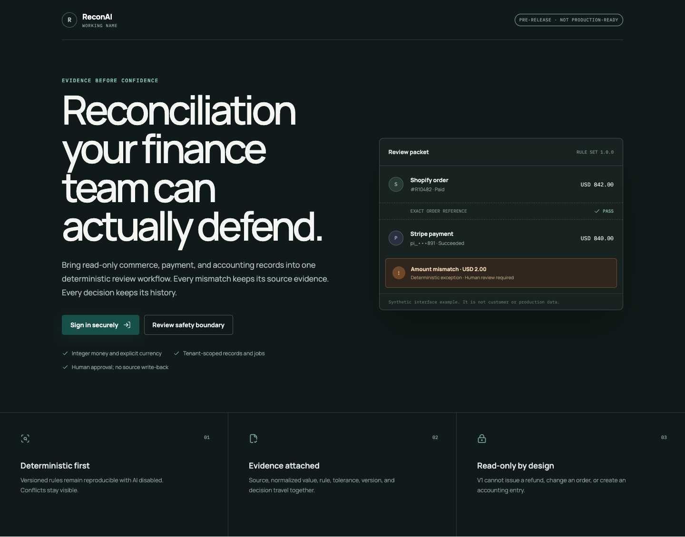

# ReconAI

[](https://github.com/ostenmatrixx/ReconAI/actions/workflows/ci.yml)
[](https://github.com/ostenmatrixx/ReconAI/actions/workflows/security.yml)
[](LICENSE)

> **Working name:** a basic collision review found multiple existing ReconAI products and an
> occupied `@reconai` npm scope. Do not publish packages, images, or releases under this name until
> the owner completes naming and legal review. See [the name review](docs/name-review.md).

Open-source, self-hosted reconciliation for e-commerce finance and operations teams.

ReconAI brings read-only Shopify and Stripe data plus accounting CSVs into one deterministic review
workflow. It normalizes every record with provenance, applies versioned matching rules, and surfaces
evidence-backed exceptions for a human to review. V1 never writes financial changes back to a source
system.

**Project status:** this repository contains a locally verified vertical slice and passing hosted
CI. It is a pre-release system and is **not production-ready**. See [Goals and evidence](GOALS.md)
for measured progress and remaining gaps.



_Synthetic interface example. It contains no customer or production data._

## What it does

- Ingests read-only Shopify orders/refunds, Stripe payments/refunds, and accounting CSVs.
- Preserves raw source representations separately from normalized, versioned values.
- Reconciles integer minor-unit money without binary floating point or implicit currency conversion.
- Produces reproducible matches and explainable exceptions from immutable inputs.
- Keeps tenant-scoped evidence, review decisions, and append-only audit history.
- Supports optional, disabled-by-default AI assistance that cannot approve or override rules.

## Safety model

| Boundary       | Guarantee                                                                                       |
| -------------- | ----------------------------------------------------------------------------------------------- |
| Source systems | V1 connectors are read-only; ReconAI cannot issue refunds or alter source records.              |
| Money          | Amounts use integer minor units with explicit ISO 4217 currency codes.                          |
| Tenancy        | Customer-owned records, jobs, storage keys, and queries require server-resolved tenant context. |
| Decisions      | Deterministic, versioned rules are authoritative; human review remains explicit.                |
| AI             | Optional and disabled by default; it may explain or rank, never approve or change money.        |
| Audit          | Review and system events are append-only under normal application roles.                        |

The detailed security boundary and known limitations live in the
[threat model](docs/threat-model.md), [security review](docs/security-review.md), and
[known limitations](docs/known-limitations.md).

## Architecture

ReconAI is a strict TypeScript pnpm monorepo:

- `apps/web`: Next.js operator interface and authentication boundary.
- `apps/api`: Fastify authorization, validation, and orchestration API.
- `apps/worker`: BullMQ connector, ingestion, retention, and reconciliation jobs.
- `packages/domain`: dependency-light money, permission, and domain invariants.
- `packages/database`: PostgreSQL migrations, tenant-bound repositories, RLS, and outbox.
- `packages/reconciliation`: deterministic, versioned matching and exception rules.
- `packages/connectors` and `packages/connector-*`: read-only connector contracts and adapters.
- `packages/ai`: optional provider-neutral, structured assistance.

PostgreSQL, Redis, S3-compatible object storage, and standards-based OIDC remain replaceable
self-hosting boundaries. See [Architecture](docs/architecture.md) and the
[architecture decisions](docs/adr/).

## Quick start

### Prerequisites

- Node.js 24.18 or a compatible active LTS
- Corepack and pnpm 11.9.0 (pinned in `package.json`)
- Docker with Compose v2, or Podman with an external Compose provider

### Run locally

```sh
corepack enable
pnpm install --frozen-lockfile
cp .env.example .env
pnpm hooks:install
pnpm infra:up
pnpm db:migrate
pnpm fixtures:load
pnpm dev
```

Open `http://localhost:3000`. The quick start uses synthetic fixtures and local services; it needs
no paid account, production credential, or customer data. Set `RECONAI_COMPOSE_ENGINE=docker` or
`podman` only when both are installed and you need an explicit choice.

For configuration and troubleshooting, use the [self-hosting guide](docs/self-hosting.md) and
[environment reference](docs/environment.md).

## Evaluate the project

Start with the bounded local checks:

```sh
pnpm verify
pnpm test:integration
pnpm test:e2e
```

Optional live-local verifiers exercise fresh loopback infrastructure:

```sh
pnpm verify:live-reconciliation
pnpm verify:live-oidc-bootstrap
pnpm verify:reconciliation-load
pnpm verify:clean-source -- --evidence-output artifacts/<dated-clean-source-evidence>.json
```

`pnpm verify` covers formatting, linting, strict type checking, deterministic and tenant tests,
migration/schema invariants, source and container boundaries, evidence validation, dependency and
license policy, and builds. Hosted workflows add browser/accessibility, secret, CodeQL, dependency,
container-build, and SBOM checks.

Evidence is intentionally scoped:

- Hosted `main` CI and a non-publishing release-candidate workflow have passed.
- Local synthetic checks cover the deterministic reconciliation path, tenant isolation, browser
  flows, and bounded 100,000-record engine profiles.
- No protected staging or production deployment result exists.
- Local timing and synthetic correctness results are measurements, not SLO or production-capacity
  claims.

Read the current status in [Goals and evidence](GOALS.md), the evidence index in
[artifacts/README.md](artifacts/README.md), and the release boundary in
[docs/release.md](docs/release.md).

## Contributing

Before opening a change, read [CONTRIBUTING.md](CONTRIBUTING.md), [AGENTS.md](AGENTS.md), and the
relevant security or architecture documentation. Development and tests must use synthetic data only.

Good first issues are deliberately limited to low-risk documentation, accessibility, fixtures, or
developer-experience work. Changes to money rules, tenant isolation, authentication, migrations,
connector credentials, or AI authority require maintainer pairing.

- [Browse good first issues](https://github.com/ostenmatrixx/ReconAI/labels/good%20first%20issue)
- [Ask a question or propose an idea](https://github.com/ostenmatrixx/ReconAI/discussions)
- [Review the roadmap](ROADMAP.md)

## Documentation

- Product: [PRD](PRD.md), [Roadmap](ROADMAP.md), [Goals and evidence](GOALS.md)
- Design: [Architecture](docs/architecture.md), [Data model](docs/data-model.md),
  [Reconciliation engine](docs/reconciliation-engine.md)
- Security: [Threat model](docs/threat-model.md), [Security review](docs/security-review.md),
  [Privacy and retention](docs/privacy-and-retention.md)
- Operations: [Deployment](docs/deployment.md), [Operations runbook](docs/operations-runbook.md),
  [Backup and restore](docs/backup-restore.md), [Observability](docs/observability.md)
- Extending: [Connector development](docs/connector-development.md),
  [Dependency policy](docs/dependency-policy.md)

## Security

Do not disclose vulnerabilities, credentials, customer data, or exploit payloads in a public issue
or discussion. Use
[GitHub private vulnerability reporting](https://github.com/ostenmatrixx/ReconAI/security/advisories/new)
and follow [SECURITY.md](SECURITY.md).

## License

Apache License 2.0. See [LICENSE](LICENSE).
