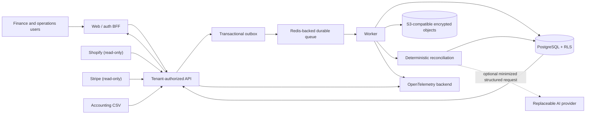

# Architecture

Status: accepted baseline for Goal 0  
Related decisions: `docs/adr/0001` through `0024`

## System context

ReconAI is a read-only reconciliation control plane. Shopify, Stripe, and accounting files remain
systems of record. ReconAI stores the minimum source evidence required to normalize, compare,
review, and audit. A human decision changes ReconAI state only.

## Deployable units

- `apps/web`: Next.js App Router. It owns browser delivery, accessible operator surfaces, and the
  standards-based session/OIDC BFF. It contains no database or connector secrets in client code.
- `apps/api`: Fastify JSON API. It performs runtime validation, session verification, tenant and
  permission resolution, CSRF/origin checks where cookie authenticated, rate limiting, and
  orchestration. It returns response schemas that minimize data.
- `apps/worker`: BullMQ consumer and scheduler. Every strict job envelope carries server-issued
  organization/actor/correlation IDs, idempotency key, schema version, attempt, and bounds; the
  worker requires an exact tenant-bound transactional-outbox authority and canonical queue identity
  before dispatching a handler. It acquires a token-digest PostgreSQL execution lease, renews it
  while the handler runs, and records success, retryability, or terminal failure through fixed
  worker-only functions.
- PostgreSQL: source of truth for control/canonical/review/audit state. Application transactions set
  `app.organization_id`; row-level security provides an independent deny-by-default control.
- Redis: transient queue, dedupe, rate, and cache state. Customer/job keys begin with environment
  and organization namespaces. Pre-authentication rate-limit keys deliberately contain an
  environment namespace plus an HMAC digest of Fastify's proxy-verified client address, never an
  organization ID or raw address. Redis is not authoritative for financial decisions. An isolated
  empty Redis queue can be reconstructed only from PostgreSQL outbox/execution classifications and
  append-only recovery evidence, never by replaying every historical published event.
- S3-compatible storage: raw payloads/imports/exports at
  `{environment}/{organization}/{purpose}/{opaque-id}`. Server-side encryption, private access,
  lifecycle, checksum, MIME metadata, and retention apply.

## Package boundaries

`domain` is dependency-light and owns branded IDs, integer money, currencies, roles/permissions,
canonical record contracts, audit/review state machines, and stable identity primitives.
`reconciliation` depends only on `domain` and implements versioned pure rules. `database` adapts
domain repositories to PostgreSQL. Connector packages adapt provider payloads into versioned raw
events and canonical records. `email` owns the replaceable invitation delivery boundary and a
dependency-light authenticated HTTP relay adapter. Apps compose these packages.

The following interfaces are explicitly replaceable and documented: `IdentityProvider`,
`ObjectStore`, `JobQueue`, `InvitationEmailProvider`, `TelemetrySink`, `AiProvider`, and deployment
manifests. Self-hosting defaults use open components and no maintainer-private service.

## Request authorization and tenant context

1. Web/API verifies a secure session with the configured standards-based identity provider.
2. API loads active user and organization membership server-side.
3. API checks the explicit permission for the requested action.
4. API constructs immutable `TenantContext { organizationId, membershipId, actorId, permissions }`.
5. Database code starts a transaction and uses parameterized
   `set_config('app.organization_id', ..., true)` before customer queries. RLS compares each row’s
   `organization_id`.
6. Repositories still include an explicit tenant predicate as defense in depth.
7. Any job/object/cache/export is derived from this context, never from an unverified body/header.

Every Fastify route is additionally present in the typed route-security inventory as public health,
authenticated identity, provider signature, or tenant authorization. Registration fails closed for
an unclassified method/template. A global pre-handler authenticates identity routes and resolves
membership plus every declared permission for tenant routes before the handler can run. The
request-local verified identity and `TenantContext` are reused, while handler-level permission
checks remain defense in depth. Invalid/missing credentials return `401`; a valid identity with no
membership and an identity without the required permission both return the same not-found `404`.
Provider webhook routes remain separate because exact raw-body signature verification establishes
their authority before any tenant resolution. See ADR 0021.

Organization discovery is also identity-derived. The API intersects the verified issuer/subject with
active users, memberships, and organizations through a narrow database function; a browser
organization UUID is only an exact filter and never a grant. Pages use a bounded
lower-name/organization-ID keyset, literal bounded search, and a schema-validated search-bound
cursor. The BFF verifies a signed selected context outside the visible page with that exact
identity-derived lookup, while every downstream tenant route still performs current membership and
permission resolution. The compatibility function used by the prior API image remains until a later
contraction migration. See ADR 0024.

### Exception queue read model

The tenant-authorized exception queue is a bounded projection over stored deterministic evidence. It
orders by severity, creation time, and opaque UUID and exposes exact ID/type search, lifecycle
status, severity, source, amount, confidence, assignment, and age filters. Source resolution expands
at most 500 exception record references and joins canonical records with the same organization
predicate under RLS; malformed, oversized, empty, or unresolved reference evidence is
`unclassified`.

Money bounds are signed integer minor units and are invalid without one exact ISO 4217 currency.
There is no queue-time rounding or conversion. Confidence is a closed review classification derived
from rule evidence: `fail` is high, `ambiguous`/`defer` is low, and other or missing evidence is
unclassified. It is not a probability or AI score. Low and unclassified evidence fail closed to two
independent reviewers when dual control is enabled.

Assignment is tenant-relative (`me`, any `assigned`, or `unassigned`) and never treats a
browser-supplied membership ID as authority. UTC age buckets use one database transaction instant.
Cursor version 2 carries that instant plus the severity/creation/ID position and a digest of every
normalized filter, keeping traversal stable. The cursor is navigation only; every page repeats
membership authorization, tenant predicates, and RLS.

The CSV export executes the same filter contract under explicit `data:export` permission, retains
fixed row/byte ceilings and spreadsheet-formula protection, and appends its normalized filter/time
snapshot to the audit chain. The browser BFF independently validates the closed filter set and
strictly minimizes queue rows to source names, confidence/assignment states, money, status, and
timestamps. See ADR 0057.

### First-organization bootstrap boundary

An OIDC identity with a provider-verified normalized email and no active membership may create
exactly one initial organization. The browser supplies only a bounded name, an IANA business time
zone, and a UUID idempotency key. The API generates every authority identifier and always creates an
active owner membership with AI disabled.

A fixed database function serializes by issuer/subject and atomically creates or resolves the user,
rechecks that no active membership exists, creates the organization and owner membership, and
appends tenant-scoped bootstrap idempotency evidence. Exact request-digest retries return the same
organization; changed input under the key and any later attempt fail closed. The application adds
the first canonical audit event in that same transaction, so an audit failure rolls everything back.

The exact-origin BFF forwards a bearer token without browser cookies, strictly validates the bounded
response, and issues the normal subject-bound selected-context cookie. The UI preserves the same
idempotency key after an uncertain response. The cookie is still navigation state; tenant routes
re-resolve the owner membership. See ADR 0025.

### Browser-facing internal API response boundary

The web tier treats internal API error bodies as untrusted input. Browser-facing routes may preserve
only a route-approved error code/status pair and a validated UUID correlation identifier. They
replace the internal message with fixed browser-safe copy; the shared parser rejects unknown codes,
status mismatches, extra fields, malformed identifiers, non-JSON content, invalid UTF-8, and bodies
over 64 KiB. A rejected error contract becomes a private generic `502` and does not preserve the
upstream status or body.

Invitation acceptance, exception CSV export, and Shopify privacy-package preparation/receipt use
this boundary. Their upstream fetches omit ambient credentials, reject redirects, use fixed
configured origins and paths, and retain existing timeouts. This controls diagnostic disclosure; it
does not replace API authorization, tenant predicates, RLS, CSRF protection, success-response
validation, or download bounds.

The shared mutation BFF applies the same strict error treatment and separately minimizes every
successful response. All 17 actions have an explicit accepted-status contract. Eight actions parse
only the data required by their browser clients and reconstruct a named response; the other nine
validate that an object response exists and emit only `{ data: { accepted: true } }`. Successful
JSON is bounded to 1 MiB and decoded as fatal UTF-8. An unexpected status, malformed body, or
invalid field becomes a private generic `502`; unrecognized upstream fields never cross the
boundary. The upstream request uses a fixed configured origin and enumerated path, omits ambient
credentials, rejects redirects, and retains the 15-second timeout.

The general read BFF also minimizes every successful view. Sixteen tenant views have exhaustive
schemas for queue/detail evidence, connections and credential metadata, membership and invitations,
imports, policies, privacy operations, provider syncs, audit history, and reconciliation run
summaries/details/pages. The separately implemented organization directory and support-grant list
remain strict and reconstructed. All 18 read modes require `200`; successful tenant JSON is bounded
to 5 MiB and decoded as fatal UTF-8. Only browser-required pagination and queue metadata survive.
API-only correlation metadata, audit before/after values, invitation authority identifiers,
credential creator/rotation fields, provider organization identifiers, import internals, and unknown
fields are removed.

The operator must display some deterministic evidence values: record references, rule evidence,
normalized values, and policy snapshots. Those named fields accept JSON only and remain under the
route's total response ceiling; surrounding objects, list sizes, hashes, timestamps, identifiers,
statuses, and provenance metadata are still validated. This is an intentional evidence surface, not
a generic pass-through. The API remains responsible for source-data minimization inside those
evidence values.

Read failures accept only four fixed browser-actionable code/status pairs
(`AUTHENTICATION_REQUIRED`, `RESOURCE_NOT_FOUND`, `INVALID_CURSOR`, and `RATE_LIMITED`) through the
shared 64 KiB error boundary. Unknown error or success drift becomes a private generic `502`.
Upstream read requests use fixed configured origins and enumerated tenant paths, omit ambient
credentials, reject redirects, and retain the eight-second timeout.

## Audit-chain topology

Each tenant has one append-only audit chain. Business `occurred_at` remains event evidence and
operator display chronology; it never selects a predecessor. Under a tenant advisory transaction
lock, the writer appends to the sole event with no child. Tenant-scoped unique event/predecessor
indexes, one genesis, a self-foreign key, hash checks, and a same-lock head-enforcing insert trigger
reject forks, orphans, cross-tenant links, self-links, and multi-row disconnected cycles even if a
writer bypasses repository head selection.

Legacy version-1 digests remain immutable and are not rewritten. Repository-authored version-2
digests use explicit authority/evidence fields, normalized UTC instants, explicit nulls, and
recursively key-sorted JSON. The schema migration aborts rather than repairing a malformed, forked,
or unreachable legacy graph. This is database-local tamper evidence, not external notarization or
protection from a fully compromised database owner.

Restricted support diagnostics are a separate platform identity boundary, not a tenant membership.
They are disabled by default and require an exact configured OIDC support group plus MFA assurance
context. A support identity creates a 15-minute organization-unbound one-time request; one active
tenant owner with the separately enumerated `support:manage` permission binds it to an exactly
confirmed organization, ticket/reason, read-only `diagnostics:view` capability, and 5–60 minute
expiry. The request plus owner approval is dual control. Fixed database functions recheck the keyed
issuer/subject digest, organization, grant, capability, status, and expiry under forced RLS.
Application and worker roles cannot read or mutate the ledgers directly; the worker cannot execute
the functions. Successful approval, diagnostic use, and revocation append to the tenant audit chain.
Diagnostics contain only capped connector/sync/reconciliation/exception/outbox aggregates; there is
no financial evidence, payload, credential, impersonation, tenant directory, or global browse
endpoint.

The browser preserves that split. `/support` uses a distinct organization-blind shell and an exact
support BFF that never reads or forwards the signed tenant-selection cookie. Its raw one-time code
is React-memory-only and never enters a URL or browser storage. The tenant Security surface uses the
normal signed organization context for owner-only grant list/approve/revoke; the BFF injects exact
organization confirmation and the API re-resolves current membership. Both paths use strict fixed
schemas, private no-store responses, bounded upstream JSON, and uniform diagnostic denial. See ADRs
0053 and 0054.

The restricted-support BFF accepts exactly `201` for organization-blind request creation and `200`
for one exact grant-bound diagnostic read. Both successful response shapes are strict,
aggregate-only, bounded to 64 KiB, and decoded as fatal UTF-8; the one-time request code is the only
intentional bearer output and is discarded from browser memory after owner handoff. Failures accept
only `AUTHENTICATION_REQUIRED`/`401`, `RESOURCE_NOT_FOUND`/`404`, or `RATE_LIMITED`/`429` through
the shared strict error envelope and fixed browser messages. Status, error, or schema drift becomes
a private generic `502`. Upstream requests use fixed paths, omit ambient credentials, reject
redirects, and retain the eight-second timeout.

### Source and verification-evidence publication boundary

Documentation-linked synthetic verification records are bounded source inputs, not disposable local
logs. Git publishes only reviewed JSON, the dated consolidated transcript, the artifact policy, and
the application SBOM; arbitrary artifact types remain ignored. `pnpm evidence:check` validates
names, sizes, JSON, documentation links, Git visibility, and personal-path redaction, while
Secretlint remains independent. `pnpm source:check` also rejects source, workflow, infrastructure,
or documentation files accidentally hidden by a broad ignore rule. `pnpm verify:clean-source` copies
only Git-ignore-clean candidates to a new temporary repository, performs the frozen install and full
static/browser verification, and rejects source drift or new publishable files. Its historical
record predates the initial commit and remains a source-export claim. `pnpm verify:literal-clone`
separately accepts only the canonical public HTTPS remote, a conservative branch, and an exact full
commit; it verifies Git object integrity, the frozen install, secret/dependency gates, Chromium, the
complete static/build gate, and a final clean tree in a bounded temporary clone. See ADRs 0055
and 0069.

### Invitation onboarding boundary

An owner or administrator with `members:manage` creates a normalized-email invitation with a reason
and initial role; only an owner can mint owner access. The API generates 256 random bits and
persists only the SHA-256 digest through a fixed tenant-checked database function. The raw token is
returned once. The UI places it in a URL fragment so it is not sent in HTTP requests or referrers,
then removes the fragment from browser history before acceptance.

When configured, the API sends a bounded invitation message synchronously to an authenticated HTTP
email relay with a five-second ceiling and redirects disabled. The raw bearer exists only in memory
and the outbound message body; it is never persisted, logged, or audited. Provider acceptance is
reported honestly as acceptance rather than inbox delivery. A disabled, rejected, or unavailable
relay still returns the one-time manual link, while a separate append-only event records only
provider/status/message-ID or stable error-code metadata. If that outcome audit fails after
invitation creation, the link is still returned and the response marks the audit failure.

Acceptance is the one authenticated route that intentionally precedes existing membership
resolution. It accepts only a bounded token in a same-origin private BFF request, requires an OIDC
`email_verified=true` claim, and atomically checks token digest, normalized email, pending state,
and 72-hour expiry before creating the user/membership and consuming the invitation. Replays,
cross-email attempts, deactivated identities, existing memberships, invalid role transitions, and
revoked/expired tokens fail closed. Creation, revocation/expiry, and acceptance append tenant audit
events without recording the raw token or digest.

The BFF accepts only an exact `201` success with the minimal invitation/membership/context fields,
reads at most 64 KiB, and decodes JSON as fatal UTF-8 before issuing the subject-bound organization
context. Oversized, malformed, expanded, or status-drifted responses receive no context cookie. The
fixed upstream request omits ambient credentials, rejects redirects, and has an eight-second
timeout; strict route-specific errors remain under the shared browser error boundary.

### Exception queue read model

The queue API accepts bounded status, severity, exact exception-ID, and normalized exact-type
filters. It orders by explicit severity rank, creation time, and UUID, then advances with an opaque
base64url keyset cursor. The cursor is schema-validated and carries a SHA-256 binding to the
normalized filter set, so a continuation cannot be accidentally reused under different filters. The
cursor is not an authorization capability: every page independently resolves membership, checks
`financial-records:view`, starts a tenant-bound RLS transaction, and includes an explicit
organization predicate.

Each response returns at most 50 rows, a filtered total, a next cursor only when another row exists,
and tenant-wide queue summary counts computed by PostgreSQL rather than inferred from the visible
page. Composite tenant/severity-rank/age/ID and tenant/type indexes support the stable order and
exact type lookup. Substring scans are intentionally excluded from this operational read path.

## Ingestion and replay

HTTP webhook handlers read a bounded raw body, verify provider authenticity before parsing, derive
provider event identity, and atomically insert a receipt plus outbox message. A duplicate receipt
returns success without a new outbox item. Workers normalize immutable raw events using recorded
connector/normalizer versions.

An authorized provider recovery request transactionally inserts immutable `provider_sync_runs`
authority plus a versioned outbox envelope. The worker reloads that exact tenant/connection/run
authority and resolves a read credential distinct from the webhook signing secret. Stripe requests
only its fixed Events and balance-transactions paths; the latter is a second cursor phase limited to
charge transactions with a minimized expanded Charge reference. Shopify accepts only a canonical
single-label `*.myshopify.com` shop, constructs the pinned Admin GraphQL version path, rejects
redirects, and requires the response version header to match. Both adapters enforce positive windows
of at most 30 days plus page, item, response-byte, timeout, cursor, retry, and total-page ceilings.
Every event or order/refund snapshot enters the same immutable receipt/object/outbox pipeline as a
webhook and retains source/API-version evidence. Operator-requested recovery and an opt-in periodic
repair scheduler now make webhooks non-authoritative for the supported Stripe event, charge-fee, and
Shopify order/refund families.

Provider secrets can remain externally managed through allowlisted environment references or be
sealed locally into AES-256-GCM envelopes. Authenticated additional data binds organization,
connection, provider, purpose, and key version. Forced-RLS append-only credential rows provide
atomic supersession/revocation evidence, while API/worker resolution rechecks the exact active
connection reference before decrypting. The browser and lifecycle API handle ciphertext and metadata
only. Provider OAuth adds a digest-only, tenant-bound, single-claim authorization attempt and stores
access/refresh tokens only as validated encrypted bundles. Near-expiry refresh locks and rotates an
immutable credential generation. Shopify disconnect confirms its lifecycle-only uninstall mutation
before local revocation. Stripe disconnect stops reads and becomes action-required until a signed
app-deauthorization event maps the global account through a narrow resolver and finalizes inside the
resolved tenant transaction.

Shopify mandatory privacy deliveries use a separate fixed app-level endpoint with the confidential
app secret. Exact-body HMAC, topic, API version, and canonical shop-domain equality are verified
before a narrow global-shop resolver establishes tenant context. Persistence discards email/phone
and retains bounded identity/digest/deadline evidence. Redaction creates only database-authorized,
checksum-bound raw-object deletion jobs; a legal-hold advisory lock spans claim, storage deletion,
and tombstone finalization. The connection remains action-required because raw deletion does not
complete data-access delivery, canonical/audit disposition, or independent-copy expiry. A
default-enabled bounded worker monitor discovers only requests inside the final seven-day window,
then re-enters the exact tenant context before creating one append-only escalation plus hash-chained
audit event for each seven-day, 24-hour, or overdue stage. The monitor logs aggregate counts only;
external notification routing and response exercises remain deployment responsibilities.

For `customers/data_request`, the API composes a tenant-bound repository with the immutable object
store to produce a complete-or-fail JSON evidence snapshot. Dual permission, explicit confirmation,
100-record/one-MiB-object/five-MiB-package bounds, checksum verification, JSON validation, and a
fixed BFF download contract prevent routine identifier exposure and partial output. Only
Shopify/Stripe evidence linked to the supplied Shopify order IDs is included; shared accounting CSV
objects are excluded. Preparation appends metadata-only audit evidence and never marks delivery or
request completion.

The complete response carries a random 256-bit browser-receipt token in private/no-store headers;
PostgreSQL stores only its SHA-256 digest, the content digest, byte count, preparing membership, and
an exact ten-minute expiry. After buffering all bytes, the browser calls a same-origin BFF receipt
variant before triggering download. A fixed tenant/request/package/same-active-membership database
function creates at most one append-only receipt and same-transaction audit event. Exact retries
return the original receipt, including after expiry. This evidence means only that the authenticated
browser received the complete bytes; downstream merchant/customer transfer, fulfillment, and
downloaded-copy expiry remain outside the system boundary.

Automatic repairs use a fixed `provider-gap-repair-scheduler` service identity rather than a
fabricated membership. Worker-only RLS-on database functions expose at most 100 due connections and
create a run/outbox pair only after rechecking exact tenant context, connection/read-credential
state, due time, active-run absence, envelope shape, and all window/page bounds. A deterministic
cadence-slot key plus an organization/connection advisory lock suppress concurrent scheduler
replicas and races with operator requests. The default is disabled; enabled cadence, lookback,
overlap, page ceiling, and batch size are startup-validated.

Raw source events are immutable and separated from canonical versions. Re-normalization creates a
new canonical version referring to the same raw event; it never overwrites provenance.

An authorized accounting-import rollback takes the same organization-scoped advisory lock used to
select new reconciliation inputs. It appends one tenant-isolated, immutable
`canonical_record_supersessions` marker per imported record, terminally marks the import
`rolled_back`, and appends a reasoned audit event in one transaction. Raw objects, source events,
canonical rows, field provenance, and already-pinned run inputs are retained. New run snapshots
exclude the exact superseded record versions.

### Raw-object retention boundary

Retention is disabled unless an authorized organization administrator explicitly configures a
bounded raw import/provider duration. A reasoned legal hold suspends both classes. The application
role updates only tenant-RLS policy rows; the worker has no direct retention-table access and can
call only fixed-query claim/finalize/fail functions.

Claiming selects one due terminal source, locks its policy row, and holds that transaction through a
15-second-bounded checksum/ETag/version-bound object deletion. Finalization rechecks policy, hold,
source state, object authority, duration, and due time before appending a tombstone. This deliberate
serialization prevents a policy or legal-hold update racing deletion. Batches and retries are
bounded; failures dead-letter after ten attempts. Canonical/provenance/reconciliation/review/audit
evidence remains intact, and object noncurrent versions/backups remain separate lifecycle domains.

## Reconciliation run

An authorized API transaction selects the latest canonical version of each record, validates its
normalized-content hash, computes the stable run identity, inserts the queued run, appends exact
`(record_id, version, content_hash, ordinal)` inputs, stores the complete JSON-safe evaluated
policy, and writes a tenant-bound outbox envelope. It never computes artifacts synchronously. The
worker validates the queued envelope against that outbox authority, uses the worker database role,
reloads only the pinned record versions, verifies every hash and the complete run identity, and then
invokes the engine.

Input persistence uses deterministic batches of at most 1,000 rows inside that same transaction.
Each row contributes six bound parameters, keeping a full statement at 6,000 parameters while
retaining the original global ordinal. At the configured 100,000-record ceiling this is 100 input
statements rather than 100,000 per-row executions. The queued run, complete input ledger, first
dispatch, and request audit still commit or roll back as one authority; batching never creates a
partially authoritative run.

The maximum-volume verifier exercises that rollback boundary after the first 1,000-row statement: a
database rejection at ordinal 1,000 aborts the second statement and leaves no run, input, outbox, or
audit row. The rejection mechanism is verifier-only and removed before the same deterministic
snapshot is created successfully.

Run creation also starts a bounded application authority deadline before pool admission, combines it
with API request-abort state, and installs the same transaction-local PostgreSQL `statement_timeout`
after admission. Every direct creation query is cancellable, and signal checks separate parsing,
identity derivation, input batches, outbox, and audit work. Interruption leaves the existing tenant
transaction to roll back all authority and maps to one fixed retry-safe `503`. PostgreSQL
`transaction_timeout` is not used because it terminates the session; postgres.js pool acquisition
remains outside the cancellable boundary.

The repository observes the transaction promise and the abort signal separately. If the signal wins
during pool admission, the caller settles immediately while the same aborted signal continues to
guard the queued transaction and its eventual queries. The driver promise stays observed and, after
capacity returns, fails before an authority query. This bounds repository response settlement
without pretending to cancel postgres.js admission.

A fail-fast process-local gate now bounds how many heavyweight run transactions may be constructed
for the driver. The default is two per API process and the validated range is 1–10. An admitted
lease is released by the underlying database promise, not by the public response promise, so hidden
work after a deadline cannot reopen admission early. The gate has no waiting queue and contains no
tenant or financial data. Shared Redis request admission, bounded replica count, PostgreSQL/pool
sizing, and rejection/latency monitoring remain required; event-loop, ingress, and network behavior
remain outside this repository boundary.

Abrupt process or connection loss is an ambiguous-commit boundary: PostgreSQL can detect a closed
connection and roll back, or it can complete the atomic transaction before detecting loss. The
correctness contract is therefore zero authority or one fully complete authority—never a partial
ledger—plus stable-key retry convergence. The loopback process-loss verifier kills the actual
creator during the delayed second batch and validates that contract before retry. A separate policy
snapshot starts two direct creator processes and requires a live PostgreSQL observation of one
organization advisory-lock waiter before accepting their shared run authority. This is single-host
evidence; multi-host partitions and supervisor behavior remain deployment concerns.

A run therefore freezes organization, exact input versions, policy/rule/engine versions, initiating
actor, correlation, and dispatch count. The deterministic engine:

1. builds exact external-ID candidates;
2. builds deterministic composite candidates;
3. validates integer amount/currency;
4. validates date/customer evidence;
5. applies captured bounded tolerance;
6. generates non-authoritative weighted ambiguous candidates;
7. optionally asks AI only to rank/explain ambiguous candidates;
8. persists stable matches/exceptions for human review.

Stable identifiers are derived from organization, run input identity, rule version, exception type,
and sorted source record versions. Database uniqueness plus idempotent transactions prevent replay
duplicates. A failed/partial/cancelled run may be recovery-replayed only with permission, explicit
reason, confirmation, and a bounded incremented dispatch; the original inputs and policy are reused
and newer source data is never substituted. Succeeded runs are terminal. AI output never changes
deterministic results.

Run execution also takes an organization-scoped transaction lock before mutating artifacts.
Completion authority is ordered by immutable run creation time and UUID. A successful run applies
exception status, evidence, proposal supersession, and queue totals only when no newer run has
already succeeded. Applying a newer run atomically retires the previous authority under a partial
unique index. A late older run still persists its immutable counts and occurrence history, but
cannot move `latest_run_id` backward, reopen a superseded exception, or supersede newer work. New
workers also append an exact per-occurrence artifact snapshot in the same transaction. This
separates immutable evidence observed by a run from the stable match/exception row whose current
workflow state can change later.

Every first observation, automatic supersession, and authoritative re-observation appends an
`exception_status_events` row. These rows are tenant-isolated, worker-insert-only, and protected
against update/delete. The investigation timeline combines them with occurrences, notes, proposals,
approvals, and user audit events. Run list/detail responses explicitly distinguish the single live
queue authority from historical-only successful results.

Editing a pending resolution proposal is an immutable revision, not an update. Only the original
proposer may request it while the exception still has exactly one pending proposal. The transaction
locks the tenant-scoped exception authority row, marks the old proposal `superseded`, creates a new
proposal ID and monotonically increasing version, recomputes the required approval count from the
current organization policy, and appends `resolution.revised` before commit. Existing approval rows
remain append-only and bound to the old proposal ID/version; none count toward the replacement. An
approval transaction resolves the proposal, locks the same exception authority row first, then locks
the proposal, so concurrent approval/revision requests serialize without moving approval authority
between versions. The browser receives only the server-derived `canRevise` decision, never proposer
identity, and requires an explicit confirmation that prior approvals will remain historical.

Run detail returns the first 100 pinned input record/version/content-hash references in immutable
ordinal order. A truncated preview can be replaced and extended through 100-row API/BFF ordinal
keyset pages. The canonical base64url cursor binds the server-derived tenant, run, and last ordinal;
it grants no authority. Every page rechecks `financial-records:view`, run existence, tenant
predicates, and forced RLS. The existing unique `(organization_id, run_id, ordinal)` index supports
the query without a migration. The client validates UUID, positive version, SHA-256, strictly
increasing ordinal, cursor shape, and cross-page non-overlap before appending evidence.

Run detail returns a bounded preview of ten matches and ten exceptions. Snapshot-backed rows are
identified as exact at observation. A rolling-window occurrence from an older worker is joined to
the current artifact only as an explicitly labeled legacy projection and cannot be represented as
immutable history. Operators can replace a truncated preview with stable artifact-ID keyset pages.
The API admits 1–100 rows and the BFF always requests 25. Each canonical base64url cursor is bound
to the server-derived tenant, run, artifact type, and last immutable artifact ID; it is navigation
state, not authority. Every page rechecks `financial-records:view`, run existence, tenant
predicates, and forced RLS. The existing occurrence primary key supports the query without a
migration. Identity order is stable rather than chronological, so each row continues to display its
separate `observedAt` value. The web BFF caps each complete upstream JSON response at five MiB
before parsing.

## Consistency and failure model

- PostgreSQL transaction + transactional outbox avoids database/queue dual writes.
- Workers are at-least-once; handlers are idempotent and record attempt/result through a durable,
  token-digest execution lease. Heartbeats prevent an active handler from becoming stale merely
  because it runs longer than the initial lease window.
- Exponential backoff is bounded and jittered; terminal failures enter a tenant-scoped DLQ.
- Safe replay requires permission and reason and produces an audit event.
- Queue disaster recovery admits only due unpublished, tracked never-started, retryable, or both
  lease-expired and operator-stale running work. Active, succeeded, dead-lettered, and legacy
  published/no-ledger rows are excluded.
- Connector/run state distinguishes queued, running, partially succeeded, succeeded, retrying,
  failed, cancelled, and stale.
- Every Shopify/Stripe recovery page is admitted through a required Redis-backed circuit scoped to
  environment, fixed provider, tenant, and connection. Atomic permit-token transitions coordinate
  replicas, allow one half-open probe, honor bounded retry-after guidance, and fail closed before a
  provider request when the circuit store is unavailable. Scheduled repair preserves eventual
  freshness after bounded retry; the circuit is ephemeral protection, never sync or financial
  authority.
- Stripe recovery uses versioned Events and balance-transaction cursor phases. The empty Events
  terminal page advances explicitly to a separate balance request and circuit permit. Balance
  snapshots retain only required transaction and Charge-reference fields, require integer minor-unit
  conservation, and never authorize currency conversion or provider writes.
- If AI/storage/telemetry/email is unavailable, deterministic reconciliation continues when safe;
  affected optional behavior is explicitly degraded, never silently omitted.

## Security architecture

The security baseline includes short/revocable server-side sessions; conditional Secure,
HttpOnly/SameSite cookies; CSRF/origin protections; a discovered Next.js request proxy that emits a
fresh script/style nonce, denies production style attributes, permits form redirects only to self
and the validated configured OIDC origin, and applies the same CSP to rendering and the response;
runtime input/output schemas; body/file/rate limits; outbound-host allowlists; encrypted, versioned
connector secrets; RLS; append-only audit restrictions; redacted structured telemetry; immutable
action/container inputs; dependency/secret/static/container scanning; SBOM/checksum/signed candidate
evidence; backups; and key rotation.

The web session is an encrypted, bounded NextAuth JWT with a distributed server-side revocation
check. Keycloak can POST a signed OIDC Logout Token to the fixed back-channel endpoint. The web
boundary pins issuer, audience, asymmetric algorithm, token age, event and Keycloak JWKS URL, stores
only HMAC-indexed `sid`/`sub` cutoffs and `jti` replay markers, and checks them in NextAuth plus
every server page/BFF cookie path. Production requires the shared Redis index; an unavailable index
fails authenticated admission closed while liveness remains independent. `sid` targets one provider
session, while a token without `sid` applies a subject cutoff to earlier sessions only.

The exact stable NextAuth path currently binds its transitive `openid-client@5.7.1` to a
lockfile-hash-bound compatibility patch that replaces the deprecated legacy URL parser with WHATWG
`URL`. The OIDC security gate scans the installed dependency and executes discovery, callback,
logout, and optional Passport URL behavior under `--throw-deprecation`; configured issuers must
already be canonical. This patch does not replace or expand session authority and must be removed or
rebased deliberately when a stable upstream authentication path preserves the complete refresh,
logout, revocation, BFF, and API contract. ADR 0059 records the decision.

A fresh isolated Keycloak 26.7.0 exercise runs this exact patched path under fatal Node deprecation
handling and covers authorization-code/S256 PKCE, access and refresh-token rotation, RP logout,
signed Back-Channel Logout into one actual Next.js process, replayed old-cookie denial, and repeat
login. A second isolated exercise runs two production-built Next.js processes with one authenticated
persistent Redis 8.2.8 authority. It proves two distinct same-subject sessions across both replicas,
targeted `sid` revocation, cross-replica replay, fail-closed authenticated admission during an
abrupt Redis stop, independent liveness, durable restart, and unaffected/later-session recovery.
Those results validate single-host component composition only; the production architecture still
requires protected TLS ingress, multi-host scheduling and partitions, managed Redis behavior, clock
and secret/signing-key rotation, and alert exercises.

Only the reverse proxy is internet-facing in self-hosting. It handles TLS, malformed/slow request
controls, header/body limits, and an outer connected-peer rate budget. Its access log is an explicit
JSON allowlist containing only operational response/correlation fields and normalized query-free
paths; callback queries, referrer, cookies, authorization, user-agent, and arbitrary request strings
are not configured. Browser `/api/*` routes stay on the Next.js BFF/auth boundary; direct `/v1/*`
provider/API routes reach Fastify without path rewriting. Fastify accepts forwarding data only
through explicit direct-proxy CIDRs and uses a dedicated, bounded Redis connection to share
pseudonymous per-address budgets across replicas. Production rejects local limiting, empty proxy
trust, or missing limiter key configuration. A single-host composition exercise now proves one
120-request budget across two compiled production API processes, fail-closed Redis process loss,
durable restart, and coordinated drain/restart HMAC-key rotation. This does not replace protected
multi-host, managed-failover, ingress, load, or alert verification. Web, API, worker, data stores,
and object storage remain private. Egress can be restricted to configured provider hosts and
telemetry endpoints.

## Observability

The API accepts bounded W3C trace context and emits explicit server spans; the worker emits explicit
durable-job consumer spans. The generated correlation ID continues across API, outbox, worker,
connector, and reconciliation logs. Reconciliation run requests, signature-verified provider
webhooks, tenant-authorized CSV commits, and user-requested provider syncs persist a versioned,
locally-sampled trace parent in the immutable outbox envelope. Provider-sync consumers capture their
active authorized span for child webhook jobs. The context is part of stable job identity, and the
worker honors it only after exact tenant-bound outbox authorization; older jobs and scheduled sync
requests without the field start separate roots. Logs carry service/environment/correlation and
active trace/span IDs, never secrets/raw payloads/full payment or unnecessary personal data.
Implemented metrics cover API result/duration, durable-job result/duration, deterministic
reconciliation aggregate results/duration, outbox dispatch outcomes, leased queue state/frontier,
provider webhook/normalization/event-lag, bounded scheduled-repair due-candidate freshness, and
committed proposal-decision age plus approved-exception final-resolution age with closed-vocabulary
labels. The durable-queue lease owner also refreshes attribute-free, environment-wide unresolved
exception presence/oldest-age gauges through a fixed worker-only database function and an online
partial index; followers and failed/expired observations publish no stale snapshot. Customer
identifiers, money, credentials, payloads, and raw timestamps are excluded. The same lease owner
observes the oldest queued/running Shopify and Stripe sync through two fixed indexed lookups,
publishing only provider, fixed active state, and age. Per-object provider completeness, unresolved
counts/severity, optional AI signals, and protected alerting remain planned. The tenant-authorized
connection view now returns classification-backed fixed-family source/receipt watermarks,
never-observed state, or a connection-wide classification-unavailable state when even one
operational receipt lacks immutable family evidence. It does not infer completeness or normalization
success. A dedicated non-bypass maintenance role can repair allowlisted legacy gaps only through
one-row locked, integrity-verified, exact-classifier functions that append fixed audit evidence; it
has no direct source/classification/audit table access. A disabled-by-default one-way database fence
serializes activation against source-writer transactions and then requires exact compatible
classification at commit. Provider sync attempts emit fixed trigger/outcome/duration metrics, and
provider-request circuits emit fixed decisions/transitions without tenant identifiers. See
`docs/observability.md` and ADRs 0036–0052.

Liveness reports process health only. Readiness concurrently checks PostgreSQL, the Redis authority
used by queues/production admission, and the private immutable-object bucket behind one bounded,
single-flight, one-second-cached probe. Its public response is only `ready` or opaque `not_ready`;
fixed component classifications appear only in transition logs. OIDC, provider APIs, optional email,
and deliberately non-blocking OTLP are excluded from readiness. Detailed connector and tenant health
is authenticated and tenant-scoped. See ADR 0023.

## Environments and configuration

Development, test, staging, and production have separate credentials, databases, buckets, queues,
OIDC clients, encryption keys, and telemetry namespaces. Runtime configuration is validated at
startup. Production fails closed when placeholder/local-auth/demo values are present.

Local development uses containerized PostgreSQL, Redis, MinIO, and an OIDC provider with synthetic
fixtures. Test suites never contact live providers. Staging uses provider sandboxes and production-
like topology. Production deployment always requires explicit approval, an exact registry image
digest with verified expected-workflow provenance and SBOM, a migration/rollback plan, health
verification, and smoke tests. The repository's signed local OCI candidate workflow supplies
pre-publication evidence only and has no registry or deployment authority.

## Known architectural limits

No protected-staging, representative end-to-end load, or complete restore evidence exists yet. A
local five-process pure-engine exercise now covers one deterministic mixed 100,000-record profile,
but excludes API/database/queue/persistence/network stages and sustained concurrency. Shipping and
QuickBooks are not V1 milestone-one connectors. Cross-region active-active, automatic currency
conversion, source write-back, and autonomous resolution are intentionally absent. See
`docs/known-limitations.md`.

The implemented deterministic engine is version `0.7.0` with rule set `1.5.0`. Its exact financial
joins use indexed lookup structures. Identity-bearing fields are checked before those indexes are
built; an unsafe value preserves the canonical input and creates explicit evidence while
quarantining the whole affected record from automatic reconciliation. A refund/accounting
relationship becomes an exact artifact only when one bounded normalized-reference/currency/amount
candidate belongs to one refund or when one complete 2–50-row positive strong-reference bucket
conserves the refund total. The engine never chooses a subset or aggregates by order reference;
competing, non-conserving, reused, or overflowing candidates fail closed. Ambiguous order/payment
search fully scores a population of at most 500, but a larger indexed range fails closed with exact
counts and no partial shortlist. Local 99,999-record, complete-taxonomy, split/refund-accounting,
refund-accounting 500/501, payment 500/501/10,000, and restricted-role PostgreSQL persistence
regression measurements exist. An isolated continuous Chromium-to-restricted-worker run also
persists and renders the same conserved two-row split. Representative source/accounting
distributions, concurrent load, operator outcomes, and staging remain unmeasured. See ADRs 0017,
0026, 0027, 0029, and 0067.
